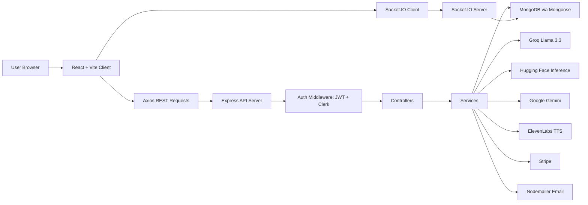
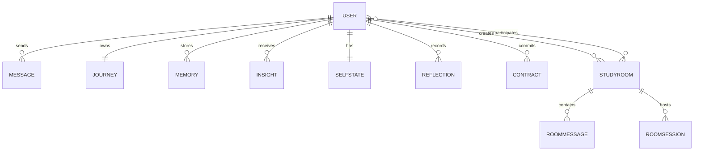
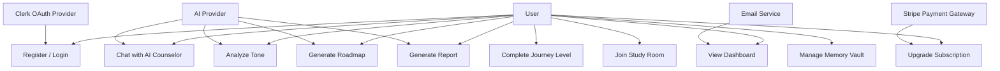
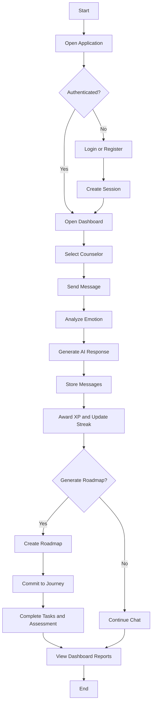
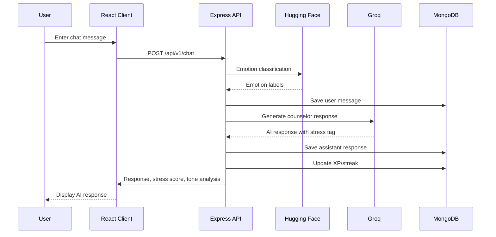
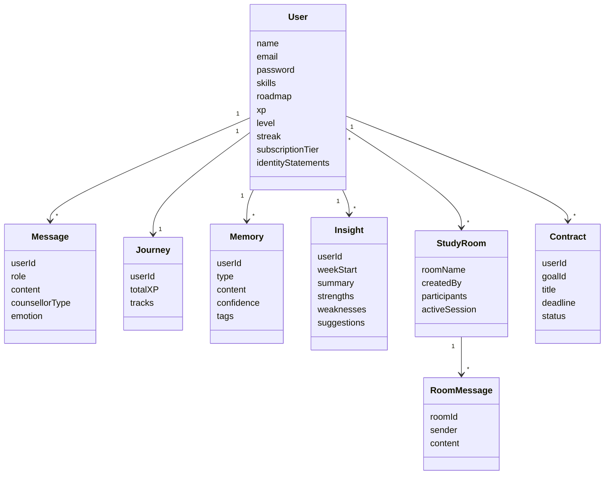
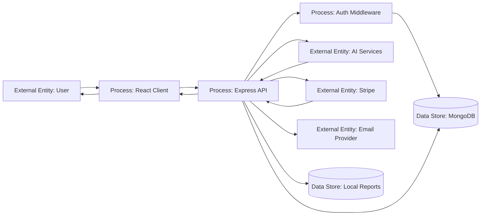

# Mind-Guide: Complete Project Documentation Package

**Prepared for:** Final Year Major Project Report Submission  
**Project Repository:** `MindGuide`  
**Documentation Basis:** Direct analysis of the React client and Node.js/Express server source code  
**Prepared On:** 03 June 2026

---

## 1. Project Title

**Mind-Guide: An AI-Powered Personal Growth, Learning Roadmap, Emotional Mentorship, and Collaborative Study Platform**

Short title: **Mind-Guide**

Category: **AI-native SaaS Web Application / Personal Growth Operating System / AI Study Guide and Emotional Mentor**

---

## 2. Abstract

### Purpose

Mind-Guide is a full-stack web application designed to support students, self-learners, career switchers, and personal-growth-oriented users through AI-assisted mentoring, emotion-aware chat, learning roadmap generation, gamified progress tracking, session reports, memory-based personalization, weekly insights, goal contracts, and collaborative study rooms.

The project attempts to combine three traditionally separate software domains:

- AI tutoring and mentoring.
- Emotional wellness and self-reflection.
- Progress tracking and gamified learning.

### Problem Solved

Many users require structured guidance but struggle with fragmented systems: one application for learning, another for mental wellness, another for productivity, and another for collaboration. Mind-Guide solves this fragmentation by providing a unified platform where users can talk to specialized AI counselors, convert advice into actionable roadmaps, complete roadmap levels, track emotional states, and receive progress reports.

### Target Users

- College and school students who need academic, career, or emotional guidance.
- Self-learners building technical and non-technical skills.
- Career switchers who need structured learning plans.
- Users seeking reflective self-improvement and guided accountability.
- Small study groups that need collaborative focus rooms.

### Key Features

- Multi-persona AI counselor chat.
- Emotion and stress analysis using NLP and AI-generated stress tags.
- Roadmap generation from conversations.
- Gamified journey map with XP, levels, badges, streaks, and assessments.
- Memory vault for persistent user context.
- Session debriefs, reflections, and PDF/CSV intelligence reports.
- Weekly AI-generated insights delivered through dashboard and email.
- Collaborative study rooms with real-time chat and focus sessions.
- Subscription-based premium access through Stripe.
- Clerk OAuth plus JWT cookie authentication support.

### Technologies Used

- **Frontend:** React 18, Vite, React Router, Redux Toolkit, Tailwind CSS, Framer Motion, Chart.js, Mermaid.js, Socket.IO Client.
- **Backend:** Node.js, Express.js, MongoDB, Mongoose, Socket.IO, JWT, Clerk Express, Stripe, Nodemailer, PDFKit, json2csv.
- **AI/ML Services:** Groq Llama 3.3, Hugging Face emotion/personality models, Google Gemini, ElevenLabs Text-to-Speech.
- **Storage:** MongoDB collections and local server report storage.

### Expected Impact

Mind-Guide is expected to improve learner clarity, reduce decision fatigue, increase engagement through gamification, and provide structured self-development workflows. The project demonstrates how conversational AI can be combined with analytics, emotion recognition, roadmap planning, and collaborative learning to form a practical AI mentorship platform.

---

## 3. Problem Statement

### Existing Problem

Students and self-learners often face difficulty in selecting correct learning paths, maintaining motivation, managing emotional stress, and converting advice into measurable progress. Existing applications usually address only one part of the problem. Learning platforms provide courses but rarely provide emotional context. Wellness applications provide meditation or counseling support but usually do not generate technical learning paths. Productivity tools track tasks but do not understand the user’s emotional or academic situation.

### Limitations of Existing Systems

- Online learning platforms provide content but often lack personalized mentoring.
- Wellness platforms focus on emotional support but do not convert discussions into actionable learning plans.
- Gamified learning platforms motivate users but usually restrict learning to predefined domains.
- AI chatbots provide answers but often fail to persist memory, progress, and measurable outcomes.
- Collaboration tools provide communication but are not integrated with AI-based learning analytics.

### Why This Project Was Needed

Mind-Guide was needed to bridge the gap between advice and execution. A user should not only receive a helpful AI response but should also be able to:

- Save the conversation context.
- Extract emotional insights.
- Generate a structured roadmap.
- Convert roadmap steps into trackable levels.
- Earn XP and badges for progress.
- Review analytics and reports.
- Collaborate with peers in real time.

Thus, the project provides an integrated solution for learning, mentorship, emotional intelligence, and accountability.

---

## 4. Objectives

### Main Objective

To design and implement an AI-powered web platform that delivers personalized guidance, emotional support, gamified learning progress, analytical reporting, and collaborative study-room functionality through a scalable MERN-based architecture.

### Specific Objectives

- To implement secure user registration, login, OAuth synchronization, and protected route access.
- To provide multiple specialized AI counselor personas for academic, career, technical, personal, financial, health, wellness, and emotional support use cases.
- To analyze user tone and emotional state from messages.
- To generate AI-based chat responses that adapt to counselor type and detected emotion.
- To extract stress indicators from AI responses and represent them in the user interface.
- To create AI-generated roadmaps from conversations.
- To convert roadmaps into gamified journey tracks.
- To implement XP, levels, streaks, badges, recovery score, and assessments.
- To generate session reports in PDF and CSV format.
- To provide memory-based personalization through a memory vault.
- To generate weekly insight reports using scheduled jobs.
- To support collaborative study rooms through REST APIs and real-time Socket.IO events.
- To implement subscription-based premium features using Stripe.
- To provide a dashboard for reports, wellness data, gamification, reflections, memory vault, and profile management.

---

## 5. Scope of the Project

### Current Scope

The current implementation includes:

- User registration and login using JWT cookies.
- Clerk-based OAuth synchronization.
- Protected frontend and backend routes.
- AI counselor chat using Groq.
- Hugging Face emotion and personality analysis endpoints.
- ElevenLabs text-to-speech support.
- Roadmap creation, revision, task update, and journey commitment.
- Journey map with levels, tasks, MCQ assessment generation, and progress updates.
- Gamification profile including XP, level, badges, streak, and recovery score.
- Weekly insight generation and email delivery.
- Session debrief and reflection storage.
- Memory vault viewing and deletion.
- Identity statement management.
- Study room creation, listing, joining, leaving, messaging, and focus sessions.
- Real-time room events through Socket.IO.
- Stripe subscription checkout, webhook handling, portal session, and plan status.
- Report generation and protected report download.

### Future Scope

Potential future extensions include:

- Dedicated admin panel for managing users, counselors, reports, subscriptions, and platform analytics.
- Production-ready deployment with cloud object storage for reports.
- Stronger medical-safety guardrails for emotional support conversations.
- End-to-end encryption for highly sensitive user reflections.
- Mobile application using React Native.
- Role-based access control for admin, counselor, moderator, and student roles.
- Advanced recommendation engine for resources and study material.
- Group analytics for study rooms.
- Improved automated test coverage.
- API documentation through OpenAPI/Swagger.
- Internationalization and multilingual UI support.
- Integration with calendar tools for reminders and goal deadlines.

---

## 6. Literature Survey

### Existing Solutions in the Market

| Existing Solution | Main Focus | Relevant Features | Limitations Compared with Mind-Guide |
|---|---|---|---|
| BetterHelp | Online therapy and counseling | Text, chat, audio, and video sessions with licensed therapists | Not designed as a learning roadmap, gamification, or study collaboration platform |
| Headspace | Meditation, mindfulness, coaching, and mental health habits | Guided meditation, sleep support, emotional wellbeing resources | Does not convert user goals into technical or academic journey maps |
| Coursera | Online courses, certificates, and degree programs | Structured learning content and professional certificates | Provides learning content but lacks emotion-aware personal mentoring and custom AI-generated roadmaps |
| Duolingo | Gamified language learning | XP, streaks, levels, quizzes, game-like progression | Domain-specific to languages and does not provide open-ended mentoring or emotional analytics |
| General AI chatbots | Conversational assistance | Flexible question answering and explanations | Usually lack application-level progress tracking, persistent journey maps, reports, and study room collaboration |

### Similar Research and Projects

Research on conversational agents for mental health indicates that AI chatbots can support scalable assistance, but such systems require careful evaluation, ethical boundaries, safety checks, and transparent design. Research on gamified learning platforms also shows that game mechanics such as XP, streaks, and levels can motivate users, but may become harmful if overused or poorly aligned with learning outcomes.

Mind-Guide incorporates these lessons by using gamification as a supportive progress mechanism rather than as the only learning mechanism. It also stores reflections, insights, and emotional states to encourage self-awareness.

### Comparison with Existing Solutions

| Criterion | Typical Learning Platform | Typical Wellness App | Typical AI Chatbot | Mind-Guide |
---|---|---|---|---|
| Personalized conversation | Limited | Sometimes | Strong | Strong |
| Emotional analysis | Rare | Strong | Limited | Strong |
| Learning roadmap | Strong but predefined | Rare | Possible but not persisted | AI-generated and persisted |
| Gamified journey | Sometimes | Rare | Rare | Integrated |
| Session reports | Rare | Sometimes | Rare | PDF and CSV reports |
| Long-term memory | Limited | Limited | Model-dependent | Application-level memory vault |
| Collaborative study rooms | Rare | Rare | No | Implemented |
| Subscription model | Common | Common | Common | Implemented with Stripe |

### How Mind-Guide Is Different

Mind-Guide is different because it combines AI counseling, emotional state detection, learning roadmap generation, gamified execution, memory-based personalization, weekly insights, and real-time collaboration into one application. The system does not stop at answering questions; it converts conversations into measurable growth workflows.

---

## 7. System Analysis

### Functional Requirements

- The system shall allow users to register with name, email, password, and optional profile picture.
- The system shall allow users to log in through JWT cookie authentication.
- The system shall support Clerk OAuth user synchronization.
- The system shall protect authenticated routes from unauthorized access.
- The system shall allow users to select counselor personas.
- The system shall allow users to send and retrieve counselor-specific chat messages.
- The system shall detect emotional tone from user messages.
- The system shall generate AI counselor responses using persona-specific prompts.
- The system shall extract stress scores from AI-generated responses.
- The system shall award XP for chat activity.
- The system shall update daily streaks based on user activity.
- The system shall generate roadmaps from chat conversations.
- The system shall store user roadmaps in MongoDB.
- The system shall convert roadmaps into journey tracks and levels.
- The system shall allow users to complete journey tasks.
- The system shall generate MCQ assessments for journey levels.
- The system shall update progress after assessment completion.
- The system shall generate session debriefs and reflections.
- The system shall generate PDF and CSV reports.
- The system shall provide report download functionality.
- The system shall create and manage study rooms.
- The system shall support real-time study room events.
- The system shall support Stripe checkout and webhook-based subscription updates.
- The system shall restrict premium features by subscription tier.
- The system shall generate weekly insight reports and send email summaries.

### Non-Functional Requirements

- **Security:** Passwords must be hashed, protected routes must validate sessions, and report downloads must verify user ownership.
- **Performance:** Indexed MongoDB queries should support chat history and weekly analytics retrieval.
- **Scalability:** Controllers and services should be modular to support additional AI providers and features.
- **Reliability:** Provider failures should be handled with fallbacks where possible, especially in emotion analysis and email sending.
- **Maintainability:** The codebase should follow a controller-service-model structure on the backend and a page-component structure on the frontend.
- **Usability:** The interface should provide clear dashboards, counselor cards, reports, roadmaps, and journey visualizations.
- **Interoperability:** The system should communicate with external AI APIs, Stripe, Clerk, email services, and Socket.IO clients.
- **Portability:** The application should run locally using Node.js, Vite, MongoDB, and environment variables.

### User Requirements

- Users need simple registration and login.
- Users need a dashboard to view progress and reports.
- Users need personalized AI guidance.
- Users need emotional support and wellness feedback.
- Users need actionable learning plans.
- Users need visible motivation through XP, streaks, and badges.
- Users need downloadable reports for reviewing their growth.
- Users need study rooms for peer collaboration.
- Users need premium upgrade options for advanced features.

---

## 8. System Design

### Complete Architecture Explanation

Mind-Guide follows a **MERN client-server architecture**:

- The **React client** renders pages, handles routing, sends API requests through Axios, and manages authentication state through Redux and Clerk.
- The **Express server** exposes REST APIs under `/api/v1/*`, handles authentication, coordinates controllers, and calls business services.
- **MongoDB** stores users, messages, roadmaps, journeys, memories, insights, reports, rooms, sessions, and contracts through Mongoose schemas.
- **External AI services** generate counselor responses, roadmaps, assessments, insights, reports, emotion analysis, personality analysis, and speech output.
- **Socket.IO** enables real-time study room communication.
- **Stripe** manages subscription checkout, portal links, and webhook-based plan updates.
- **Nodemailer** sends weekly insight reports through email.

### High-Level Architecture Diagram



### Workflow Explanation

1. The user opens the React application.
2. The client loads routes through React Router.
3. Protected routes verify user state.
4. The user logs in or registers.
5. The backend validates credentials and sets a JWT cookie, or synchronizes Clerk OAuth users.
6. The user selects a counselor type.
7. The chat page sends messages to the backend.
8. The backend analyzes emotion and generates an AI response.
9. The response and user message are stored in MongoDB.
10. XP and streaks are updated.
11. The user can generate a roadmap from the conversation.
12. The roadmap can be committed to the journey map.
13. The user completes tasks, takes assessments, and unlocks levels.
14. Reports, reflections, memories, and weekly insights are generated for long-term tracking.
15. Study rooms enable collaborative learning through REST APIs and Socket.IO events.

### Module-Wise Explanation

- **Frontend Routing Module:** `client/src/App.jsx` defines all UI routes and protected sections.
- **Authentication Module:** `server/middleware/authMiddleware.js`, login/register pages, Clerk provider, and Redux user state.
- **AI Chat Module:** `server/controllers/chatControllers.js` and `client/src/pages/ChatApp.jsx`.
- **Roadmap and Journey Module:** `server/controllers/journeyController.js`, `server/services/journeyService.js`, and `client/src/pages/JourneyMap.jsx`.
- **Gamification Module:** `server/services/gamificationService.js`, `server/controllers/gamificationController.js`, and dashboard widgets.
- **Report Module:** `server/services/analysisService.js`, `server/reports`, and `client/src/components/ReportModal.jsx`.
- **Insight Module:** `server/services/insightService.js`, `server/services/cronService.js`, and `WeeklyInsightWidget`.
- **Study Room Module:** `server/controllers/studyRoomController.js`, `server/socket/index.js`, `StudyRooms.jsx`, and `LiveRoom.jsx`.
- **Subscription Module:** `server/services/stripeService.js`, `paymentRoutes.js`, and upgrade pages.
- **Memory and Reflection Module:** `Memory.js`, `Reflection.js`, `Vault.jsx`, and `ReflectionPage.jsx`.

---

## 9. Technology Stack

| Technology | Why Selected | Advantages | Role in Project |
|---|---|---|---|
| React 18 | Component-based UI development | Reusable components, hooks, ecosystem support | Builds the frontend interface |
| Vite | Fast frontend tooling | Fast dev server and optimized builds | Runs and bundles React app |
| React Router | Client-side navigation | Nested routes and protected pages | Manages page routing |
| Redux Toolkit | Central state management | Simplified reducers and predictable state | Stores authenticated user info |
| Tailwind CSS | Utility-first styling | Rapid responsive UI development | Styles pages and components |
| Framer Motion | Animation library | Smooth UI transitions | Enhances interface polish |
| Chart.js | Data visualization | Simple charts for analytics | Displays stress and dashboard metrics |
| Mermaid.js | Diagram rendering | Converts text diagrams into visuals | Visualizes roadmap/architecture-like content |
| Node.js | JavaScript backend runtime | Single-language full stack | Runs backend server |
| Express.js | Web server framework | Simple routing and middleware | Provides REST API endpoints |
| MongoDB | Document database | Flexible schema for AI/user data | Stores application data |
| Mongoose | ODM for MongoDB | Schema modeling and validation | Defines models and relationships |
| Socket.IO | Real-time communication | WebSocket-like events with fallback | Powers study room presence and chat |
| JWT | Session authentication | Stateless authentication tokens | Legacy cookie-based auth |
| Clerk | OAuth/user management | External identity provider support | Synchronizes OAuth users |
| bcryptjs | Password hashing | Protects stored passwords | Hashes user passwords |
| Groq SDK | Fast LLM inference | Chat completions and JSON generation | Main AI counselor, reports, insights, quizzes |
| Hugging Face Inference | NLP model access | Hosted text classification models | Emotion and personality analysis |
| Google Gemini | Generative AI API | Content generation support | Skill extraction from roadmap goals |
| ElevenLabs | Text-to-speech | Natural speech synthesis | Voice playback for counselor responses |
| Stripe | Payment infrastructure | Checkout, subscriptions, webhooks | Premium subscription management |
| Nodemailer | Email delivery | SMTP support | Weekly insight email delivery |
| PDFKit | PDF generation | Programmatic document creation | Session report PDFs |
| json2csv | CSV conversion | Converts JS objects to CSV | Session report CSV files |
| node-cron | Task scheduling | Scheduled backend jobs | Weekly insights and contract checks |

---

## 10. Database Design

Mind-Guide uses MongoDB with Mongoose models. Collections behave similarly to tables in relational systems, while embedded arrays represent nested subdocuments.

### Collections / Tables

#### User

Purpose: Stores identity, authentication, roadmap, gamification, subscription, wellness, and profile data.

Important fields:

- `name`
- `email`
- `clerkId`
- `password`
- `pic`
- `skills`
- `roadmap`
- `sessionHistory`
- `reportHistory`
- `xp`
- `level`
- `streak`
- `lastActive`
- `badges`
- `subscriptionTier`
- `subscriptionExpiry`
- `stripeCustomerId`
- `stripeSubscriptionId`
- `recoveryScore`
- `recoveryEvents`
- `identityStatements`
- `burnoutScore`
- `energyLevel`

#### Message

Purpose: Stores user and assistant chat messages.

Important fields:

- `userId`
- `role`
- `content`
- `counsellorType`
- `timestamp`
- `emotion`

Indexes:

- `{ userId: 1, createdAt: -1 }`
- `{ userId: 1, emotion: 1 }`

#### Journey

Purpose: Stores gamified learning tracks and levels.

Important fields:

- `userId`
- `totalXP`
- `tracks`
- `tracks.id`
- `tracks.title`
- `tracks.levels`
- `levels.title`
- `levels.description`
- `levels.tasks`
- `levels.resources`
- `levels.status`
- `levels.xpReward`

#### Memory

Purpose: Stores extracted user memories for future AI personalization.

Important fields:

- `userId`
- `type`
- `content`
- `confidence`
- `tags`
- `isActive`
- `lastReinforcedAt`

#### Insight

Purpose: Stores weekly insights and session debriefs.

Important fields:

- `userId`
- `weekStart`
- `summary`
- `strengths`
- `weaknesses`
- `suggestions`
- `emotionBreakdown`
- `messagesAnalyzed`
- `levelsCompleted`
- `sessionDebriefs`
- `burnoutScore`
- `burnoutTrend`
- `energyLevel`

Index:

- `{ userId: 1, weekStart: -1 }`

#### SelfState

Purpose: Stores the current emotional and behavioral identity state of a user.

Important fields:

- `userId`
- `currentVibe.emotion`
- `currentVibe.intensity`
- `currentVibe.drivingFactors`
- `identityState.communicationStyle`
- `identityState.opennessScore`
- `identityState.primaryGoal`
- `history`

#### Reflection

Purpose: Stores generated session reflections.

Important fields:

- `userId`
- `date`
- `content`
- `moodSnapshot`
- `keyTakeaway`
- `growthArea`

#### Contract

Purpose: Stores user goal commitment contracts.

Important fields:

- `userId`
- `goalId`
- `title`
- `description`
- `deadline`
- `status`
- `commitmentLevel`
- `checkInFrequency`
- `checkIns`
- `penaltyXP`
- `rewardXP`

#### StudyRoom

Purpose: Stores collaborative room metadata.

Important fields:

- `roomName`
- `description`
- `createdBy`
- `category`
- `visibility`
- `maxParticipants`
- `participants`
- `roomXP`
- `activeSession`
- `tags`
- `isArchived`

#### RoomMessage

Purpose: Stores messages exchanged inside study rooms.

Important fields:

- `roomId`
- `sender`
- `content`
- `messageType`
- `reactions`
- `metadata`

#### RoomSession

Purpose: Stores collaborative focus session details.

Important fields:

- `roomId`
- `goal`
- `startedAt`
- `endedAt`
- `durationMinutes`
- `participants`
- `totalRoomXPGained`
- `status`

### Relationships

| Source Collection | Relationship | Target Collection | Description |
|---|---|---|---|
| User | One-to-many | Message | A user has many chat messages |
| User | One-to-one | Journey | A user has one journey document |
| User | One-to-many | Memory | A user has many memories |
| User | One-to-many | Insight | A user has many weekly insights |
| User | One-to-one | SelfState | A user has one emotional state profile |
| User | One-to-many | Reflection | A user has many reflections |
| User | One-to-many | Contract | A user has many goal contracts |
| User | One-to-many | StudyRoom | A user can create many rooms |
| StudyRoom | One-to-many | RoomMessage | A room has many messages |
| StudyRoom | One-to-many | RoomSession | A room has many focus sessions |

### ER Diagram Explanation



The ER diagram shows the user as the central entity. Most system records are user-centric because personalization, analytics, progress, and reports depend on user identity. Study rooms form a collaborative branch where multiple users participate in rooms, send messages, and join focus sessions.

---

## 11. API Documentation

Base URL:

```text
http://localhost:3005/api/v1
```

Most protected endpoints require authentication through `protectCookie`, which checks Clerk authentication first and JWT cookie authentication second.

### User and Authentication APIs

| Endpoint | Method | Request | Response | Purpose |
|---|---|---|---|---|
| `/user/` | POST | `{ name, email, password, pic? }` | Created user object | Register a new user |
| `/user/login` | POST | `{ email, password }` | User profile and JWT cookie | Authenticate a user |
| `/user/getUserProfile` | GET | Cookie or Clerk session | User object or `null` | Fetch logged-in user profile |
| `/user/logout` | POST | Cookie session | `{ message }` | Clear authentication cookie |
| `/user/roadmap` | GET | Authenticated request | `{ roadmap }` | Fetch saved user roadmap |
| `/user/userDashboard` | GET | Authenticated request | `{ user }` | Fetch dashboard data |
| `/user/allReports` | GET | Authenticated request | Report history array | Fetch downloadable reports |
| `/user/reflections` | GET | Authenticated request | `{ success, data }` | Fetch reflection history |
| `/user/uploadpdf/:counsellorType` | POST | Multipart `file` | `{ message, url, user }` | Upload/archive report PDF |
| `/user/getSkills` | GET | Authenticated request | Updated user | Extract skills from roadmap through Gemini |
| `/user/memories` | GET | Authenticated request | `{ success, data }` | Fetch memory vault entries |
| `/user/memories/:id` | DELETE | Memory ID | `{ success, message }` | Delete a memory |
| `/user/identity-statements` | POST | `{ text }` | `{ success, data }` | Add identity statement |
| `/user/identity-statements/:id` | DELETE | Statement ID | `{ success, message }` | Delete identity statement |
| `/user/upgrade-success` | POST | `{ sessionId }` | `{ success, user }` | Verify Stripe checkout success |

### Chat and AI APIs

| Endpoint | Method | Request | Response | Purpose |
|---|---|---|---|---|
| `/chat/:counselorType` | GET | Counselor type, query `language` | Chat messages | Fetch prior chat history for counselor |
| `/chat/` | POST | `{ messages, counsellorType }` | `{ text, stressScore, toneAnalysis }` | Send chat message and receive AI response |
| `/chat/analyze-tone` | POST | `{ text }` | Emotion classifier output | Analyze emotional tone |
| `/chat/personality` | POST | `{ text }` | Personality classifier output | Analyze personality traits |
| `/chat/tts` | POST | `{ text, language?, playbackSpeed?, voiceId? }` | MP3 audio stream | Convert text to speech |
| `/chat/report` | POST | `{ chat, userName, counsellorType }` | `{ reportData, pdfUrl, csvUrl }` | Generate session intelligence report |
| `/chat/download/:fileName` | GET | File name | File download | Download user-owned report |
| `/chat/roadmap` | POST | `{ chat }` | AI roadmap text/JSON | Generate roadmap from chat |
| `/chat/roadmap` | PUT | `{ roadmap }` | `{ message }` | Update roadmap task status |
| `/chat/updateroadmap` | POST | `{ roadmap, messages }` | Updated roadmap text | Ask AI to update roadmap |
| `/chat/roadmap/revise` | POST | `{ steps, comments }` | `{ steps }` | Revise roadmap using inline feedback |
| `/chat/roadmap/commit` | POST | `{ title?, steps }` | `{ success, trackId, journey }` | Commit roadmap to journey map |

### Journey APIs

| Endpoint | Method | Request | Response | Purpose |
|---|---|---|---|---|
| `/journey/` | GET | Authenticated request | `{ success, data }` | Fetch journey map |
| `/journey/` | POST | `{ goal }` | `{ success, data }` | Create manual journey track |
| `/journey/assessment` | POST | `{ trackId, levelId }` | `{ success, data }` | Generate 3-question MCQ quiz |
| `/journey/progress` | PATCH | `{ trackId, levelId, passed }` | Journey/progress result | Complete or fail a level |
| `/journey/tasks` | PATCH | `{ trackId, levelId, taskIndex, done }` | Updated journey | Toggle task completion |
| `/journey/continue` | POST | `{ trackId }` | Updated journey | Generate next advanced journey levels |

### Gamification APIs

| Endpoint | Method | Request | Response | Purpose |
|---|---|---|---|---|
| `/gamification/profile` | GET | Authenticated request | XP, level, badges, streak, next threshold | Fetch gamification profile |

### Insight APIs

| Endpoint | Method | Request | Response | Purpose |
|---|---|---|---|---|
| `/insights/latest` | GET | Authenticated request | `{ success, data }` | Fetch latest weekly insight |
| `/insights/trigger` | POST | Pro/Enterprise user | Generated insight | Manually generate weekly insight |
| `/insights/debrief` | POST | `{ counsellorType }` | Session debrief | Generate debrief, memories, self-state, reflection |

### Payment APIs

| Endpoint | Method | Request | Response | Purpose |
|---|---|---|---|---|
| `/payment/config` | GET | Authenticated request | Publishable key and price IDs | Fetch Stripe frontend config |
| `/payment/create-checkout` | POST | `{ priceId }` | `{ url }` | Create Stripe checkout session |
| `/payment/webhook` | POST | Stripe event payload | `{ received: true }` | Handle Stripe webhook events |
| `/payment/portal` | GET | Authenticated request | `{ url }` | Create Stripe customer portal link |
| `/payment/status` | GET | Authenticated request | `{ tier, expiry, isPro }` | Fetch subscription status |

### Goal Contract APIs

| Endpoint | Method | Request | Response | Purpose |
|---|---|---|---|---|
| `/contracts/` | GET | Authenticated request | Active contracts | Fetch active user contracts |
| `/contracts/` | POST | `{ goalId, title, deadline, commitmentLevel }` | Created contract | Create goal contract |
| `/contracts/:id/checkin` | POST | `{ status, note }` | Updated contract | Add check-in to contract |

### Study Room APIs

| Endpoint | Method | Request | Response | Purpose |
|---|---|---|---|---|
| `/rooms/` | GET | Query `search`, `category` | Room list | Fetch public rooms |
| `/rooms/` | POST | `{ roomName, description, category, visibility, maxParticipants, tags }` | Created room | Create study room |
| `/rooms/:id` | GET | Room ID | Room and messages | Fetch room details |
| `/rooms/:id/join` | POST | Room ID | Updated room | Join a room |
| `/rooms/:id/leave` | POST | Room ID | `{ message }` | Leave a room |
| `/rooms/:id/session/start` | POST | `{ goal, duration }` | Created session | Start focus session |
| `/rooms/:id/message` | POST | `{ content, messageType, metadata }` | Room message | Send room message |

### Socket.IO Events

| Event | Direction | Payload | Purpose |
|---|---|---|---|
| `join_room` | Client to server | `{ roomId, user }` | Join real-time room channel |
| `leave_room` | Client to server | `{ roomId, user }` | Leave room channel |
| `send_message` | Client to server | `{ roomId, message }` | Broadcast room message |
| `new_message` | Server to clients | Message object | Receive room message |
| `start_focus_session` | Client to server | `{ roomId, duration }` | Broadcast focus session start |
| `focus_session_started` | Server to clients | `{ duration }` | Notify users of session start |
| `sync_timer` | Client to server | `{ roomId, timeLeft }` | Sync focus timer |
| `timer_updated` | Server to clients | `timeLeft` | Receive timer update |
| `complete_focus_session` | Client to server | `{ roomId, summary }` | Complete focus session |
| `presence_update` | Client to server | `{ roomId, userId, status }` | Update presence |
| `send_reaction` | Client to server | `{ roomId, reaction }` | Broadcast reaction |

---

## 12. Modules

### User Module

The user module manages registration, login, profile retrieval, dashboard data, reports, roadmap retrieval, skills extraction, memories, reflections, and identity statements. It is implemented mainly through `server/routes/User.js`, `server/controllers/userControllers.js`, and `server/model/User.js`.

### Authentication Module

The authentication module supports two authentication flows:

- JWT cookie authentication for traditional email/password login.
- Clerk OAuth synchronization for external identity providers.

The middleware first checks Clerk authentication and then falls back to JWT cookies. Protected APIs use `protectCookie`.

### AI Counselor Module

The counselor module provides specialized AI personas such as General, Technical, Career, Academic Counselor, Financial Counselor, Health & Wellness, Student Life Counselor, Emotional Support, Senior Engineer, Therapy-Inspired, and Startup Founder. Each persona has a system prompt defining role, tone, and response constraints.

### Chat Module

The chat module stores user and assistant messages, detects user emotion, generates AI replies, extracts stress scores, and awards XP. It is the core interactive module of the project.

### Roadmap Module

The roadmap module converts conversations into structured action plans. Roadmaps contain goals, descriptions, timelines, recommendations, tasks, and completion status.

### Journey Module

The journey module converts roadmaps into gamified tracks. Each track contains levels, resources, tasks, XP rewards, and status values such as locked, unlocked, or completed.

### Gamification Module

The gamification module awards XP, calculates levels, updates streaks, tracks recovery score, and awards badges. It motivates continuous use and visible progress.

### Analytics and Insight Module

The analytics module aggregates weekly messages, emotions, and completed levels. It then generates personalized weekly insight reports and sends them by email.

### Memory Vault Module

The memory module extracts stable facts, goals, emotional patterns, milestones, and preferences from conversations. Active memories are injected into future prompts to personalize AI responses.

### Reflection Module

The reflection module stores session summaries, mood snapshots, key takeaways, and growth areas generated after debrief analysis.

### Report Module

The report module generates professional session intelligence reports in PDF and CSV format. Reports include executive summary, key insights, SWOT analysis, emotional profile, and strategic roadmap.

### Study Room Module

The study room module allows users to create rooms, join rooms, send messages, and start focus sessions. Socket.IO events provide real-time room interaction.

### Notification Module

The notification module is currently implemented through email-based weekly insights using Nodemailer. It can be expanded to include in-app notifications and push notifications.

### Payment and Subscription Module

The payment module integrates Stripe Checkout, webhooks, customer portal, and subscription status. Premium counselors and selected insight actions are restricted to pro or enterprise users.

### Admin Module

The current codebase does not contain a separate visual admin dashboard. Administrative behavior is currently system-managed through backend services such as scheduled jobs, Stripe webhooks, reports, and database records. A dedicated admin module is recommended as a future enhancement.

---

## 13. Security Features

### Authentication

- Email/password users are authenticated with JWT cookies.
- Passwords are hashed using `bcryptjs`.
- Clerk OAuth users are synchronized into MongoDB.
- Protected backend routes use authentication middleware.

### Authorization

- Premium actions are protected by `requirePlan`.
- Pro-only counselor personas check subscription tier before generating responses.
- Free users are restricted to one active goal contract.

### Data Protection

- User passwords are never stored in plain text.
- Report downloads verify that the filename contains the requesting user’s ID.
- CORS is restricted to local frontend origins.
- Stripe webhooks validate signatures with `STRIPE_WEBHOOK_SECRET`.

### Encryption

- Password hashing is implemented through bcrypt.
- Transport-level encryption is expected in production through HTTPS.
- Database encryption at rest and end-to-end encryption are not explicitly implemented in the current source code and should be added in production environments.

### Security Limitations

- JWT cookie configuration does not explicitly show `httpOnly`, `secure`, or `sameSite` flags in the current code.
- Socket.IO events rely on client-provided user payloads and should be strengthened with authenticated socket middleware in production.
- Local report storage should be replaced by secure object storage for deployment.
- Some frontend requests use hard-coded localhost URLs and should be centralized through environment variables.

---

## 14. Algorithms Used

| Algorithm / Logic | Purpose | Working | Advantages |
|---|---|---|---|
| Emotion Classification | Detect emotional tone | Sends user text to Hugging Face `j-hartmann/emotion-english-distilroberta-base`; sorts labels by confidence | Adds emotional intelligence to chat |
| Personality Classification | Analyze personality traits | Uses Hugging Face `KevSun/Personality_LM` model | Supports self-awareness tools |
| Persona Prompt Selection | Match counselor behavior to domain | Maps counselor type to predefined persona prompt and domain hints | Provides specialized AI guidance |
| Stress Score Extraction | Quantify stress | AI response appends `[[STRESS_LEVEL: X]]`; regex extracts X and removes tag | Produces measurable stress analytics |
| XP Award Algorithm | Reward engagement | Adds XP after chat or level completion | Encourages consistent use |
| Level Calculation | Convert XP into levels | `level = floor(sqrt(xp / 50))` | Non-linear scaling prevents overly fast leveling |
| Next Level XP | Calculate threshold | `(currentLevel + 1)^2 * 50` | Provides predictable progression |
| UTC Streak Algorithm | Track daily activity | Compares calendar days in UTC | Avoids timezone-related 24-hour bugs |
| Recovery Score | Reward return after gap | Adds recovery points after broken streak | Encourages users to restart without shame |
| Badge Awarding | Recognize milestones | Checks badge definitions against user state | Provides achievement feedback |
| Roadmap-to-Journey Mapping | Convert AI plan into levels | Maps roadmap steps to journey levels with tasks/resources | Converts advice into trackable execution |
| Level Unlocking | Sequential progress | Unlocks next level after completed level | Creates guided progression |
| MCQ Assessment Generation | Verify learning | AI generates 3 MCQs for a level topic | Adds validation before progress update |
| Weekly Aggregation | Generate insights | Aggregates messages, emotions, and completed levels for last week | Enables data-driven coaching |
| Memory Extraction | Persist user context | AI extracts structured facts/goals/preferences from conversations | Personalizes future counselor replies |
| Report Generation | Summarize sessions | AI creates analysis; PDFKit/json2csv export files | Supports formal review and documentation |
| Contract Finalization | Accountability | Counts check-ins and awards/penalizes XP based on deadline | Encourages goal commitment |

---

## 15. Machine Learning / AI Components

| Component | Provider / Model | Purpose | Code Location |
|---|---|---|---|
| AI counselor responses | Groq `llama-3.3-70b-versatile` | Generate persona-based counselor replies | `server/controllers/chatControllers.js` |
| Roadmap generation | Groq `llama-3.3-70b-versatile` | Generate structured plans from chat | `server/controllers/chatControllers.js` |
| Roadmap revision | Groq `llama-3.3-70b-versatile` | Revise roadmap based on comments | `server/controllers/chatControllers.js` |
| Assessment generation | Groq `llama-3.3-70b-versatile` | Generate MCQ quizzes | `server/controllers/journeyController.js` |
| Session analysis | Groq `llama-3.3-70b-versatile` | Generate debrief, SWOT, self-state, roadmap | `server/services/analysisService.js` |
| Weekly insights | Groq `llama-3.3-70b-versatile` | Generate weekly summary and suggestions | `server/services/insightService.js` |
| Memory extraction | Groq `llama-3.3-70b-versatile` | Extract user memories | `server/services/memoryService.js` |
| Burnout analysis | Groq `llama-3.3-70b-versatile` | Estimate burnout state | `server/services/burnoutService.js` |
| Emotion analysis | Hugging Face emotion DistilRoBERTa | Classify emotion in user text | `server/controllers/chatControllers.js` |
| Personality analysis | Hugging Face `KevSun/Personality_LM` | Classify personality traits | `server/controllers/chatControllers.js` |
| Skill extraction | Google Gemini 2.0 Flash | Extract technical/non-technical skills from roadmap | `server/controllers/userControllers.js` |
| Text-to-speech | ElevenLabs multilingual model | Convert AI text to MP3 | `server/controllers/chatControllers.js` |

The project includes OpenAI and Anthropic SDK dependencies in `server/package.json`, but the currently inspected implementation primarily uses Groq, Hugging Face, Gemini, and ElevenLabs.

---

## 16. Project Workflow

### End-to-End Execution Flow

1. User starts the frontend application through Vite.
2. React renders the application and initializes Clerk and Redux.
3. User registers or logs in.
4. Backend creates or verifies user credentials.
5. JWT cookie or Clerk session authenticates future requests.
6. User enters the protected application area.
7. User selects a counselor persona.
8. Chat page loads existing counselor-specific messages.
9. User sends a message.
10. Backend analyzes emotion using Hugging Face.
11. Backend inserts persona prompt, memory context, identity statements, self-state, and emotion hint into the AI prompt.
12. Groq generates the counselor response.
13. Backend extracts the stress level tag.
14. User and assistant messages are stored in MongoDB.
15. XP and streak updates are triggered.
16. Frontend displays the response, emotion indicator, and stress information.
17. User can request a session report, roadmap, or debrief.
18. Roadmap is generated and stored.
19. User commits roadmap to journey map.
20. User completes tasks and takes MCQ assessments.
21. Completed levels unlock next levels and award XP.
22. Weekly cron job aggregates user data.
23. AI generates insight reports.
24. Insight email is sent through Nodemailer.
25. User reviews reports, memories, reflections, wellness, and progress from the dashboard.

---

## 17. System Architecture Diagram Explanation

The architecture diagram represents a layered system:

- **Presentation Layer:** React, Vite, Tailwind, Framer Motion, Chart.js, Mermaid.js.
- **Client Communication Layer:** Axios for REST APIs and Socket.IO client for real-time rooms.
- **API Layer:** Express server exposing `/api/v1/*` routes.
- **Security Layer:** Clerk/JWT middleware and subscription tier middleware.
- **Controller Layer:** Request validation, response formatting, and orchestration.
- **Service Layer:** AI workflows, gamification, insights, reports, memory, payments, and cron tasks.
- **Persistence Layer:** MongoDB collections via Mongoose.
- **External Integration Layer:** Groq, Hugging Face, Gemini, ElevenLabs, Stripe, and email provider.

This layered architecture improves maintainability because each major responsibility is separated into a dedicated file group.

---

## 18. UML Diagrams Information

### Use Case Diagram Information

Primary actor: **User**  
Supporting actors: **AI Provider**, **Payment Gateway**, **Email Service**, **OAuth Provider**



### Activity Diagram Information



### Sequence Diagram Information



### Class Diagram Information



### Data Flow Diagram Information



---

## 19. Testing

### Current Testing Status

No dedicated automated test suite or test script was found in the inspected `client/package.json` or `server/package.json`. The project contains build and development scripts but does not currently include Jest, Vitest, Supertest, Cypress, Playwright, or similar configured test tooling.

### Unit Testing

Recommended unit test targets:

- `calculateLevel(xp)`
- `nextLevelXP(currentLevel)`
- `generateLevelsFromRoadmap(roadmapData)`
- `unlockNextLevel(track)`
- `normalizeClassifierOutput(data)`
- `filterValidReports(reportHistory)`
- `resolvePdfFileName(report)`
- `resolveCsvFileName(report)`
- `buildInsightPrompt(userData, userName)`

### Integration Testing

Recommended integration tests:

- User registration and login.
- Protected route access with and without token.
- Chat message send and persistence.
- Roadmap generation and journey creation.
- Journey progress update after quiz pass/fail.
- Stripe webhook plan update.
- Report generation and protected download.
- Study room creation and message retrieval.

### System Testing

Recommended system tests:

- Complete user onboarding to dashboard flow.
- Counselor chat to roadmap to journey conversion flow.
- Pro subscription upgrade and premium counselor access flow.
- Weekly insight generation flow.
- Study room collaboration flow.
- Report generation and dashboard report viewing flow.

### Test Cases

| Test Case ID | Scenario | Input | Expected Result | Type |
|---|---|---|---|---|
| TC-01 | Register user | Valid name, email, password | User document created | Functional |
| TC-02 | Duplicate registration | Existing email | Error returned | Negative |
| TC-03 | Login success | Valid credentials | JWT cookie and user data | Functional |
| TC-04 | Login failure | Wrong password | Invalid credentials error | Negative |
| TC-05 | Protected dashboard | No session | Redirect or 401 | Security |
| TC-06 | Send chat | Message and counselor type | AI response, stress score, stored messages | Integration |
| TC-07 | Analyze tone | Valid text | Emotion labels and top label | Integration |
| TC-08 | Pro counselor restriction | Free user selects pro persona | 403 access denied | Authorization |
| TC-09 | Roadmap generation | Chat history | JSON roadmap generated and stored | AI workflow |
| TC-10 | Commit roadmap | Valid steps | Journey track created | Integration |
| TC-11 | Generate assessment | Track and level ID | 3-question quiz returned | AI workflow |
| TC-12 | Pass level | `{ passed: true }` | Level completed, next level unlocked, XP awarded | Functional |
| TC-13 | Fail level | `{ passed: false }` | Penalty response returned | Functional |
| TC-14 | Generate report | Chat history | PDF and CSV URLs returned | Integration |
| TC-15 | Download report | Own report filename | File downloaded | Security |
| TC-16 | Download another user report | Other user filename | 403 forbidden | Security |
| TC-17 | Create room | Valid room data | Room created | Functional |
| TC-18 | Join full room | Room at capacity | Error returned | Negative |
| TC-19 | Stripe checkout | Valid price ID | Checkout URL returned | Integration |
| TC-20 | Weekly insight | User activity data | Insight saved and email attempted | System |

---

## 20. Results

### Screens Developed

- Home page.
- Login page.
- Registration page.
- Counselor selection page.
- AI chat page.
- Tools page for tone/personality utilities.
- Dashboard layout.
- Dashboard overview page.
- Reports page.
- Profile page.
- Journey map page.
- Memory vault page.
- Reflection page.
- Study rooms listing page.
- Live study room page.
- Upgrade pricing page.
- Upgrade success page.
- Upgrade cancellation page.
- Visual roadmap page.

### Features Implemented

- Secure registration and login.
- Protected routing.
- AI counselor chat.
- Emotion analysis.
- Stress score extraction.
- Text-to-speech support.
- Roadmap generation.
- Interactive roadmap revision and commit.
- Journey map creation.
- Task completion.
- AI-generated assessments.
- XP and level tracking.
- Badges and streaks.
- Report generation and download.
- Weekly insights.
- Memory vault.
- Identity statements.
- Reflections.
- Study rooms and real-time socket events.
- Stripe subscription workflow.

### Achievements

- A complete MERN-based AI mentorship platform was implemented.
- The project demonstrates integration with multiple AI services.
- The platform converts conversational advice into actionable journey maps.
- Emotional analytics and gamification are integrated into the learning workflow.
- Real-time collaboration is supported through study rooms.
- Subscription logic is connected to premium feature access.

---

## 21. Advantages

- Combines learning, emotional support, analytics, and gamification in one platform.
- Provides specialized AI counselor personas for different user needs.
- Converts chat into structured roadmaps and journey levels.
- Uses emotion analysis for more empathetic AI responses.
- Supports downloadable reports for review and academic demonstration.
- Uses modular backend architecture.
- Supports real-time collaborative study rooms.
- Provides subscription-ready SaaS architecture.
- Encourages consistency through XP, streaks, badges, and contracts.

---

## 22. Limitations

- No dedicated admin dashboard currently exists.
- Automated test coverage is not configured.
- Some frontend API URLs are hard-coded to localhost and should be moved to environment variables.
- JWT cookie settings should be hardened for production with `httpOnly`, `secure`, and `sameSite`.
- Socket.IO authentication should be strengthened.
- Report files are stored locally; cloud object storage is recommended for production.
- AI responses depend on external provider availability and API keys.
- Emotional support features are not a replacement for professional medical care.
- Some service imports and fallbacks should be reviewed before production hardening, such as the journey progress penalty path.

---

## 23. Future Enhancements

- Add an admin dashboard.
- Add complete automated test suite.
- Add Swagger/OpenAPI documentation.
- Add production deployment configuration.
- Add secure cloud storage for reports.
- Add authenticated Socket.IO middleware.
- Add crisis-safety flows and medical disclaimers.
- Add multilingual frontend interface.
- Add push notifications and reminders.
- Add group analytics for study rooms.
- Add learning resource recommendation ranking.
- Add calendar integration for contracts and roadmaps.
- Add mobile app support.
- Add role-based access control.
- Add advanced analytics dashboards.

---

## 24. Conclusion

Mind-Guide is a comprehensive AI-powered web platform that integrates conversational mentorship, emotional intelligence, learning roadmaps, gamified progress, reports, weekly insights, and collaborative study rooms. The project demonstrates practical application of the MERN stack with modern AI services and SaaS-oriented features such as subscriptions and protected premium access.

The system is academically significant because it illustrates how AI can be used not only for answering questions but also for building structured personal-development workflows. It transforms user conversations into measurable outcomes through journey maps, reports, XP, assessments, and insights. With additional production hardening, automated testing, and administrative tooling, Mind-Guide can evolve into a scalable AI mentorship and learning platform.

---

## 25. References

### Official Technology Documentation

- React Documentation: https://react.dev/reference/react
- Vite Guide: https://vite.dev/guide/
- Express.js Documentation: https://expressjs.com/
- MongoDB Documentation: https://www.mongodb.com/docs/
- Mongoose Documentation: https://mongoosejs.com/docs/
- Socket.IO Documentation: https://socket.io/docs/v4/
- Tailwind CSS Documentation: https://tailwindcss.com/docs
- Stripe Checkout Documentation: https://docs.stripe.com/payments/checkout
- Stripe Subscription Checkout Documentation: https://docs.stripe.com/payments/checkout/build-subscriptions
- Clerk React SDK Documentation: https://clerk.com/docs/references/react/overview
- Groq API Reference: https://console.groq.com/docs/api-reference
- Hugging Face Text Classification Inference: https://huggingface.co/docs/inference-providers/tasks/text-classification
- Hugging Face Emotion Model Card: https://huggingface.co/j-hartmann/emotion-english-distilroberta-base
- Google Gemini API Reference: https://ai.google.dev/api
- ElevenLabs Text-to-Speech API: https://elevenlabs.io/docs/api-reference/text-to-speech

### Market and Literature References

- BetterHelp Official Website: https://www.betterhelp.com/
- Headspace Official Website: https://www.headspace.com/
- Coursera Official Website: https://www.coursera.org/
- Duolingo Official Website: https://en.duolingo.com/
- Conversational Agent Interventions for Mental Health: https://pmc.ncbi.nlm.nih.gov/articles/PMC10182468/
- AI Mental Health Chatbot Systematic Review: https://pmc.ncbi.nlm.nih.gov/articles/PMC12434366/
- Gamification Misuse in Learning Applications: https://arxiv.org/abs/2203.16175
- Negative Effects of Gamification in Education Software: https://arxiv.org/abs/2305.08346

---

## Additional Documentation

## Folder Structure Explanation

```text
MindGuide/
├── client/
│   ├── index.html
│   ├── package.json
│   ├── vite.config.js
│   ├── tailwind.config.js
│   └── src/
│       ├── App.jsx
│       ├── main.jsx
│       ├── redux/
│       ├── pages/
│       └── components/
├── server/
│   ├── index.js
│   ├── package.json
│   ├── config/
│   ├── controllers/
│   ├── middleware/
│   ├── model/
│   ├── routes/
│   ├── services/
│   ├── socket/
│   └── reports/
├── README.md
├── PROJECT-DESCRIPTION.md
├── Mind-Guide-Documentation.md
└── mind-guide-master-plan.md
```

### Client Folder

- `client/src/pages`: Contains route-level screens such as chat, dashboard, journey map, study rooms, login, register, and upgrade pages.
- `client/src/components`: Contains reusable UI components such as layout, header, footer, report modal, roadmap component, dashboard widgets, and route protection.
- `client/src/redux`: Contains global state management for user data.
- `client/src/main.jsx`: Initializes React, Clerk, Redux, and the main application.
- `client/src/App.jsx`: Defines routes and protected route hierarchy.

### Server Folder

- `server/index.js`: Main Express server entry point.
- `server/config`: Database connection configuration.
- `server/routes`: API route declarations.
- `server/controllers`: Request handlers and orchestration logic.
- `server/services`: Business logic, AI calls, reports, insights, payments, cron tasks, and gamification.
- `server/model`: Mongoose schema definitions.
- `server/middleware`: Authentication and error middleware.
- `server/socket`: Socket.IO setup and event handling.
- `server/reports`: Generated PDF and CSV report files.

---

## File-Wise Explanation

### Backend Files

| File | Explanation |
|---|---|
| `server/index.js` | Initializes Express, middleware, routes, Socket.IO, database connection, and cron jobs |
| `server/config/connectDB.js` | Connects the backend to MongoDB using `MONGO_URI` |
| `server/middleware/authMiddleware.js` | Provides JWT, Clerk, and subscription-tier authorization middleware |
| `server/middleware/errorMiddleware.js` | Handles 404 and general Express errors |
| `server/routes/User.js` | Defines user, profile, roadmap, report, memory, and reflection routes |
| `server/routes/Chat.js` | Defines chat, AI analysis, TTS, report, and roadmap routes |
| `server/routes/Journey.js` | Defines journey, assessment, progress, task, and continuation routes |
| `server/routes/Gamification.js` | Defines gamification profile route |
| `server/routes/Insight.js` | Defines weekly insight and session debrief routes |
| `server/routes/paymentRoutes.js` | Defines Stripe checkout, webhook, portal, config, and status routes |
| `server/routes/contractRoutes.js` | Defines goal contract and check-in routes |
| `server/routes/studyRoomRoutes.js` | Defines study room REST routes |
| `server/controllers/userControllers.js` | Handles registration, login, profile, reports, skills, memories, identity statements, and upgrade verification |
| `server/controllers/chatControllers.js` | Handles AI counselor prompts, emotion analysis, chat response, TTS, reports, and roadmap operations |
| `server/controllers/journeyController.js` | Handles journey retrieval, creation, assessment, progress, tasks, and continuation |
| `server/controllers/gamificationController.js` | Returns user gamification metrics |
| `server/controllers/insightController.js` | Handles latest insights, manual insight generation, and session debrief |
| `server/controllers/studyRoomController.js` | Handles study room CRUD, joins, sessions, and messages |
| `server/services/gamificationService.js` | Implements XP, levels, streaks, recovery score, and badge logic |
| `server/services/journeyService.js` | Converts roadmaps into journey levels and unlocks levels |
| `server/services/analysisService.js` | Generates session analysis, PDF reports, and CSV reports |
| `server/services/insightService.js` | Aggregates weekly data, generates insight JSON, and sends emails |
| `server/services/memoryService.js` | Extracts and injects user memories |
| `server/services/stateService.js` | Updates user self-state from conversation analysis |
| `server/services/burnoutService.js` | Generates burnout analysis from behavioral data |
| `server/services/debriefService.js` | Generates concise session debriefs |
| `server/services/contractService.js` | Creates, checks in, and finalizes goal contracts |
| `server/services/cronService.js` | Schedules weekly insights and contract checks |
| `server/services/stripeService.js` | Creates Stripe checkout and portal sessions and handles webhooks |
| `server/services/reportUtils.js` | Validates and migrates report file references |
| `server/socket/index.js` | Configures Socket.IO room, chat, timer, presence, and reaction events |
| `server/model/User.js` | Defines user schema with authentication, progress, roadmap, subscription, and wellness fields |
| `server/model/Message.js` | Defines chat message schema |
| `server/model/Journey.js` | Defines journey, track, level, task, and resource schema |
| `server/model/Memory.js` | Defines user memory schema |
| `server/model/Insight.js` | Defines weekly insight and debrief schema |
| `server/model/SelfState.js` | Defines emotional state and identity schema |
| `server/model/Reflection.js` | Defines reflection schema |
| `server/model/Contract.js` | Defines goal contract schema |
| `server/model/StudyRoom.js` | Defines study room schema |
| `server/model/RoomMessage.js` | Defines room message schema |
| `server/model/RoomSession.js` | Defines focus session schema |

### Frontend Files

| File | Explanation |
|---|---|
| `client/src/main.jsx` | Mounts React app and wraps it with Clerk and Redux providers |
| `client/src/App.jsx` | Defines application routes, protected routes, and dashboard nesting |
| `client/src/redux/store.js` | Configures Redux store |
| `client/src/redux/mindGuideSlice.js` | Stores and clears authenticated user info |
| `client/src/pages/Home.jsx` | Landing page for authenticated users |
| `client/src/pages/LoginPage.jsx` | User login page |
| `client/src/pages/RegisterPage.jsx` | User registration page |
| `client/src/pages/Counselors.jsx` | Counselor selection screen |
| `client/src/pages/ChatApp.jsx` | Main AI counselor chat interface |
| `client/src/pages/Tools.jsx` | Tone/personality utility page |
| `client/src/pages/Dashboard.jsx` | Dashboard layout with nested links |
| `client/src/pages/JourneyMap.jsx` | Gamified journey map screen |
| `client/src/pages/StudyRooms.jsx` | Study room listing and room creation screen |
| `client/src/pages/LiveRoom.jsx` | Real-time study room screen |
| `client/src/pages/Vault.jsx` | Memory vault page |
| `client/src/pages/ReflectionPage.jsx` | Reflection history page |
| `client/src/pages/Upgrade.jsx` | Subscription upgrade page |
| `client/src/pages/UpgradeSuccess.jsx` | Stripe success verification page |
| `client/src/pages/UpgradeCancel.jsx` | Stripe cancellation page |
| `client/src/pages/VisualRoadmap.jsx` | Minimal visual roadmap placeholder |
| `client/src/components/Layout.jsx` | Common page layout |
| `client/src/components/Header.jsx` | Navigation header |
| `client/src/components/Footer.jsx` | Footer section |
| `client/src/components/ProtectRoute.jsx` | Frontend protected route wrapper |
| `client/src/components/PaywallGate.jsx` | Premium feature gate component |
| `client/src/components/ReportModal.jsx` | Report display and roadmap generation modal |
| `client/src/components/InteractiveRoadmap.jsx` | Editable roadmap UI with revision and commit actions |
| `client/src/components/AnimatedRoadmap.jsx` | Roadmap display and goal contract creation UI |
| `client/src/components/Mermaid.jsx` | Mermaid diagram rendering component |
| `client/src/components/AssistantAvatar.jsx` | Animated assistant avatar |
| `client/src/components/ErrorBoundary.jsx` | Error boundary for UI error handling |
| `client/src/components/ScrollToTop.jsx` | Scroll restoration on route change |
| `client/src/components/chat/EmotionIndicator.jsx` | Displays emotion label styles |
| `client/src/components/Dashboard/HeroDashBoard.jsx` | Dashboard overview |
| `client/src/components/Dashboard/Profile.jsx` | User profile and identity statement management |
| `client/src/components/Dashboard/GetAllReports.jsx` | Report listing and download links |
| `client/src/components/Dashboard/GetRoadmap.jsx` | Legacy roadmap viewer |
| `client/src/components/Dashboard/GamificationPanel.jsx` | XP, level, streak, and badge display |
| `client/src/components/Dashboard/WeeklyInsightWidget.jsx` | Weekly insight dashboard widget |
| `client/src/components/Dashboard/WellnessWidget.jsx` | Burnout and energy visualization |

---

## Component-Wise Explanation

### `ChatApp`

The main chat component handles counselor-specific chat, message sending, speech recognition, text-to-speech playback, report generation, debrief creation, stress history, and roadmap extraction. It communicates with `/api/v1/chat`, `/api/v1/chat/tts`, `/api/v1/chat/report`, and `/api/v1/insights/debrief`.

### `JourneyMap`

This component displays journey tracks and levels as an interactive progression map. It supports manual journey creation, task toggling, quiz generation, progress updating, and journey continuation.

### `InteractiveRoadmap`

This component receives roadmap data, supports inline comments, sends revision requests to the backend, and commits the final roadmap into the journey system.

### `ReportModal`

This component displays generated reports and allows users to create or download report-related assets. It also triggers roadmap generation from report/chat context.

### `StudyRooms`

This page lists public rooms, filters by search/category, and allows authenticated users to create collaborative rooms.

### `LiveRoom`

This page connects to the Socket.IO server, joins a room, sends messages, listens for real-time room events, and starts focus sessions.

### `Dashboard`

This layout component provides the left-side navigation for overview, reports, profile, journey, memory vault, and reflections.

### `GamificationPanel`

This widget displays XP, level, streak, recovery score, and earned badges.

### `WeeklyInsightWidget`

This widget fetches the latest weekly insight and displays summary, strengths, weaknesses, and suggestions.

### `WellnessWidget`

This widget reads wellness fields from user dashboard data and displays burnout and energy state information.

### `Vault`

This page lists user memories and allows deletion of memory entries.

### `ReflectionPage`

This page displays saved AI-generated reflections and session takeaways.

### `PaywallGate`

This component checks the user subscription tier and blocks premium content when the user does not meet the required plan.

---

## Important Code Snippets

### Express Route Mounting

```js
app.use("/api/v1/user", userRouter);
app.use("/api/v1/chat", chatRouter);
app.use("/api/v1/gamification", gamificationRouter);
app.use("/api/v1/journey", journeyRouter);
app.use("/api/v1/insights", insightRouter);
app.use("/api/v1/payment", paymentRouter);
app.use("/api/v1/contracts", contractRoutes);
app.use("/api/v1/rooms", studyRoomRoutes);
```

This snippet shows the backend API structure. Each module is mounted under a versioned REST path.

### Chat Response and Stress Extraction

```js
let modelResponse = await getGroqResponse(messagesForAI);
let stressScore = 5;
const stressRegex = /\[\[STRESS_LEVEL:\s*(\d+)\]\]/;
const match = modelResponse.match(stressRegex);

if (match) {
  stressScore = parseInt(match[1]);
  modelResponse = modelResponse.replace(stressRegex, "").trim();
}
```

This snippet extracts a numerical stress score from the AI response while hiding the internal stress tag from the user interface.

### XP Level Calculation

```js
function calculateLevel(xp) {
  return Math.floor(Math.sqrt(xp / 50));
}

function nextLevelXP(currentLevel) {
  return Math.pow(currentLevel + 1, 2) * 50;
}
```

This algorithm provides non-linear progression, meaning higher levels require increasingly more XP.

### Roadmap-to-Journey Mapping

```js
return roadmapData.map((step, index) => ({
  id: Date.now() + index,
  title: step.Goal || step.title || "Step",
  description: step.Description || step.description || "",
  tasks: normalizeTasks(step),
  resources:
    step.recommendations?.map((r) => ({
      title: r.title,
      link: r.link || r.url,
    })) ||
    step.resources?.map((r) => ({ title: r.title, link: r.url || r.link })) ||
    [],
  order: index,
  xpReward: 50,
  status: index === 0 ? "unlocked" : "locked",
}));
```

This logic converts roadmap steps into journey levels that can be tracked by the user.

### Authentication Middleware Strategy

```js
const { userId } = getAuth(req);
if (userId) {
  let user = await UserModel.findOne({ clerkId: userId });
  req.user = user;
  return next();
}

const token = req.cookies?.token;
const decoded = jwt.verify(token, process.env.JWT_SECRET);
req.user = await UserModel.findById(decoded._id).select("-password");
next();
```

This middleware supports both Clerk OAuth and legacy JWT cookie sessions.

---

## Complete Technical Summary

Mind-Guide is a modular MERN-stack application that demonstrates a modern AI-assisted SaaS architecture. The frontend is implemented in React and organized into route-level pages and reusable components. The backend is implemented in Express and organized into routes, controllers, services, middleware, models, socket handlers, and configuration files.

The core system flow begins with user authentication. Once authenticated, users can interact with AI counselor personas. The chat controller enriches prompts with persona definitions, user identity statements, self-state, and memory context. User messages are analyzed for emotion, stored in MongoDB, and then forwarded to Groq for AI response generation. Stress levels are parsed from AI responses and returned to the frontend. Each chat interaction can trigger XP and streak updates.

Roadmaps are generated from chat context and stored in the user document. They can be converted into journey tracks using the journey service. The journey system gives users a structured map of levels, tasks, resources, assessments, and XP rewards. This transforms AI advice into measurable execution.

The analytics layer includes reports, insights, debriefs, memories, reflections, and wellness states. Reports are generated as PDF and CSV files. Weekly insights aggregate chat and journey data and send email summaries. Memory extraction supports personalization by injecting relevant user context into future prompts.

The collaboration layer provides study rooms through REST APIs and Socket.IO events. Users can create rooms, join rooms, send messages, and start focus sessions. The subscription layer uses Stripe Checkout and webhooks to manage premium feature access.

Overall, Mind-Guide is a strong major-project implementation because it includes frontend design, backend API development, database modeling, authentication, third-party integrations, AI/ML components, report generation, gamification algorithms, real-time communication, and SaaS subscription logic.

